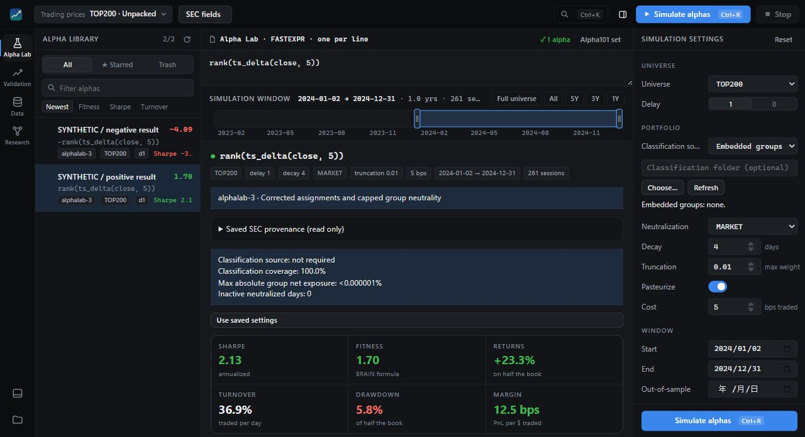
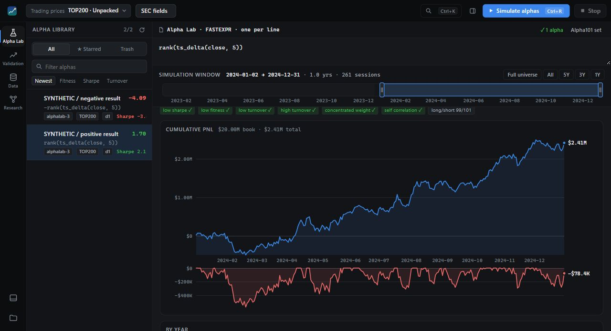
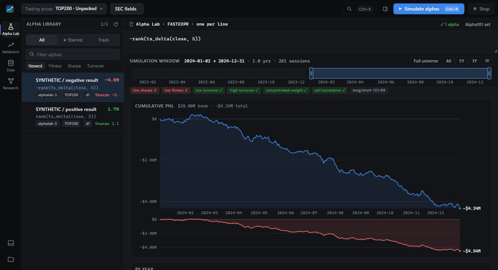

<div align="center">

# Tubby Quant

A local workbench for daily equity alpha research.

[](https://github.com/tubby-labs-research/tubby-quant/actions/workflows/tests.yml) [](LICENSE)

[Get started](#start-locally) · [User guide](docs/USER_GUIDE.md) · [Documentation](docs/README.md) · [Limitations](docs/LIMITATIONS.md)

</div>

Screen ideas in **Alpha Lab**, inspect simulation and accounting in **Qlib
Validation**, and explore separate price/volume campaigns in **Research**.
The framework does not place trades.

> **Real console, synthetic data.** Every screenshot illustrates the interface,
> not investment performance or recommended strategies.



**Early research software preview.** Interfaces and saved formats may change.
Windows x64 has bounded installation and synthetic simulation evidence;
macOS is experimental, and Linux covers core checks only.

## Three tools, distinct roles

| Tool | Use it for |
| --- | --- |
| **[Alpha Lab](docs/USER_GUIDE.md#screen-in-alpha-lab)** | Fast expression screening, batches, comparisons and saved alpha library entries. |
| **[Qlib Validation](docs/USER_GUIDE.md#validate-with-qlib)** | Detailed long-only or verified signed simulations, accounting and saved reports. |
| **[Research](docs/USER_GUIDE.md#research-campaigns)** | Separate source-backed price/volume campaigns, with a synthetic demo and optional configured model calls. |

[SEC fields](docs/SEC_FIELDS_USER_GUIDE.md) provides discoverable fundamental
definitions for Lab and Validation. Research campaigns currently exclude SEC
and dated classification inputs. Lab and Qlib use different expression syntax,
timing and accounting; matching inputs do not imply matching returns.

## Alpha Lab results

**Alpha Lab: positive outcome · SYNTHETIC TOY DATA**



**Alpha Lab: negative outcome · SYNTHETIC TOY DATA**



Both runs use the same artificial dataset and simulation settings, with the
signal's sign reversed. **Artificial data only—not evidence of investment performance.**
See [screenshot generation and provenance](docs/SCREENSHOTS.md) for inputs,
settings and capture details.

## Start locally

Install **Git and 64-bit CPython 3.12**, then clone the public source:

```bash
git clone https://github.com/tubby-labs-research/tubby-quant.git
cd tubby-quant
```

On **Windows x64**, run in PowerShell from the source folder:

```powershell
$taskDataRoot = Join-Path $env:LOCALAPPDATA 'TubbyLabs\FrameworkData'
powershell -ExecutionPolicy Bypass -File scripts\windows\setup.ps1 -Signed -NoShortcuts -DataRoot $taskDataRoot
.\env\qlib\Scripts\python.exe -m qlib_yahoo.webapp --browser --data-root $taskDataRoot
```

Setup creates the environment and verifies the pinned signed runtime;
`-NoShortcuts` avoids Desktop and Start menu changes. Keep the chosen data root
for later launches. The Windows native helper is bundled and hash-checked;
GitHub CLI and private repository access are not required. Package and pinned
public Qlib source downloads require network access.

Open **Research → Try demo** first. It uses synthetic data and deterministic
responses without model calls or provider credentials. **Setup supplies no
market dataset.** Bring your own appropriately licensed data for market research,
and keep datasets, campaigns, credentials and generated reports outside the
source folder.

See [installation and recovery](docs/INSTALL.md) for prerequisites, launch
options and experimental macOS instructions. CI covers bounded core and Windows
environment checks; it does not certify desktop operation or native signed fills.
Linux has no pinned signed runtime or verified desktop/setup path.

## Explore the documentation

| Start here | Go deeper |
| --- | --- |
| [User guide](docs/USER_GUIDE.md) — screening, validation and campaigns | [Architecture](docs/ARCHITECTURE.md) — components, storage and runtimes |
| [Data](docs/DATA.md) — synthetic demo, inputs and provenance | [SEC fields](docs/SEC_FIELDS_USER_GUIDE.md) — exact fundamental definitions |
| [Limitations](docs/LIMITATIONS.md) — simulation and historical-data assumptions | [Research Agent API](docs/RESEARCH_AGENT_API.md) — external agent configuration |
| [Release notes](docs/RELEASE_NOTES.md) — preview and verification scope | [Documentation index](docs/README.md) — all guides |

**Know the assumptions.** Lab defaults to zero turnover cost and excludes
stock-borrow expense; the screenshots explicitly use 5 bps turnover cost.
Qlib's signed simulation also has documented funding, liquidity and broker
limitations. Review the [limitations](docs/LIMITATIONS.md) before interpreting
statistics or comparing engines.

## Contribute and license

Focused fixes and reproducible synthetic examples are welcome. Read
[Contributing](CONTRIBUTING.md) for offline checks and contribution sign-off,
[AGENTS.md](AGENTS.md) for agent guidance, and [Security](SECURITY.md) for reporting
vulnerabilities. Keep private data, strategies and credentials out of issues
and contributions.

Project-owned code is licensed under **[Apache License 2.0](LICENSE)**.
Retained third-party code keeps its own licenses; see [NOTICE](NOTICE) and
[third-party notices](THIRD_PARTY_NOTICES.md).
