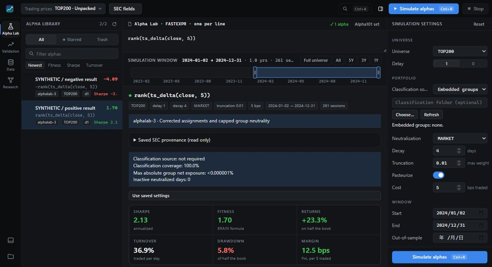
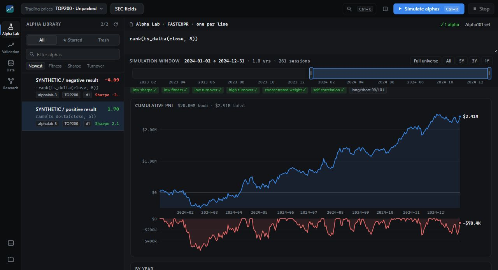
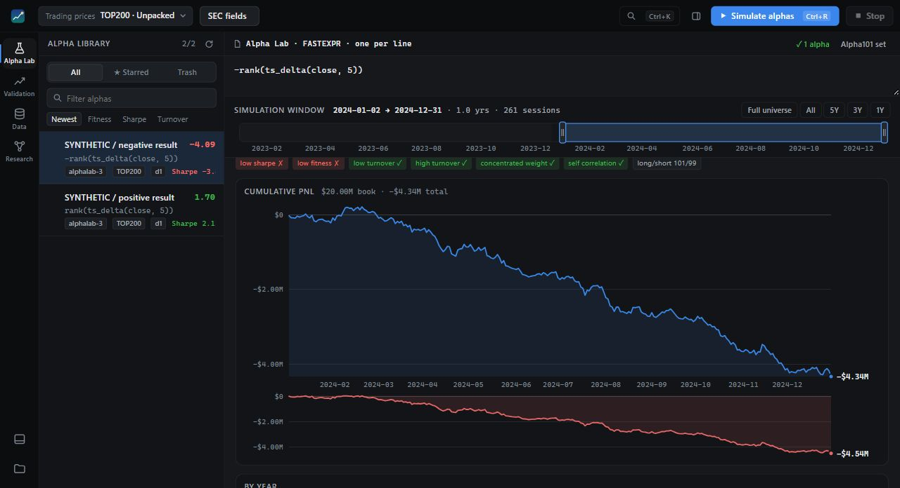

<div align="center">

# Tubby Quant

**An offline, auditable workbench for daily equity alpha research.**

BRAIN-style Alpha Lab screening · Qlib-backed long/short validation · autonomous alpha discovery and factor analysis with a sealed, once-read holdout · a research loop grounded in sources · an MCP server for agents

[](https://github.com/tubby-labs-research/tubby-quant/actions/workflows/tests.yml) [](LICENSE)

[Install](#install) · [First session](#a-first-session) · [User guide](docs/USER_GUIDE.md) · [Documentation](docs/README.md) · [Limitations](docs/LIMITATIONS.md) · [Release notes](docs/RELEASE_NOTES.md)

</div>

Tubby Quant runs WorldQuant-BRAIN-style FASTEXPR alphas on **your own daily
data, on your own machine**: the operators, neutralization, truncation, decay
and metric conventions you know from BRAIN, with every input hashed, every
universe rebuilt from what was known at the time, and every result saved with
the settings that produced it. A research harness searches for alphas or model
recipes under a budget, keeps every trial in a hash-chained ledger, and reads
the reserved holdout once per lineage. It does not place trades.

> **Real console, synthetic data.** Every screenshot shows the interface on
> purpose-made artificial data, not investment performance.



## Why it exists

- **BRAIN semantics, offline.** Screen ideas without an account, a queue or
  rate limits, on data you are allowed to use, with a simulator whose
  conventions are documented operator by operator.
- **Validation you can defend.** Point-in-time TOP-N universes, data paths
  with delisted stocks (Sharadar, HistoricalData), a Qlib derivative that fills
  at the next open with whole shares, borrow costs and restricted short
  proceeds, hash-pinned runtimes and datasets, and reports rebuilt from saved
  files.
- **Discovery that keeps its evidence.** Discover proposes alphas (typed FASTEXPR
  search) or model recipes, screens on development data only, validates with
  the deflated Sharpe ratio and robustness vetoes, records every trial in a
  hash-chained ledger and a lineage registry beside the data, and scores the
  holdout once in a Holm-controlled batch. On 200 artificial null panels the
  default policy promoted something in 1.5 % of campaigns (95 % interval
  0.31–4.32 %) and none would have reached the holdout
  ([benchmarks](docs/LAB_BENCHMARKS.md)).
- **A guided start and one design system.** The console opens on a three-step
  first session, works in light and dark with WCAG AA contrast on every surface,
  and is driven from the keyboard (`⌘K` palette). Agents get bounded MCP tools,
  never shell or trading authority.

## What is in the box

| Tool | Use it for |
| --- | --- |
| **[Start](docs/CONSOLE_QUICKSTART.md)** | Demonstration data in seconds, three starter alphas, a first campaign; every step opens the view it belongs to. |
| **[Alpha Lab](docs/USER_GUIDE.md#screen-in-alpha-lab)** | Fast FASTEXPR screening, batches with a leaderboard and in-batch correlations, a saved alpha library. |
| **[Discover](docs/LAB_DOMAINS.md)** | Autonomous alpha discovery and machine-learning factor analysis under a budget: stage timeline, budget tiles, a leaderboard with reasons, per-candidate evidence, finalize once, verify, export. |
| **[Qlib Validation](docs/USER_GUIDE.md#validate-with-qlib)** | Long-only or verified long/short simulation with an account ledger, fees and borrow; saved runs, comparisons and HTML reports. |
| **[Research](docs/USER_GUIDE.md#research-campaigns)** | Source-grounded hypothesis campaigns (reviewed ideas, Anthropic, OpenAI-compatible or your own agent), chronological evaluation, sealed holdout finals. |
| **[Evidence](docs/EVIDENCE.md)** | Every submitted attempt on record; a saved Lab result handed to signed Qlib; one or two validated signals in one account. |
| **[MCP server](docs/USER_GUIDE.md#drive-alpha-lab-from-an-agent-mcp)** | Let Claude Code, Codex or any MCP client check, simulate and compare alphas and read campaign reports inside one data root. |
| **[SEC fields](docs/SEC_FIELDS_USER_GUIDE.md)** | Discoverable fundamental definitions with point-in-time availability for Lab and Validation. |
| **[Data adapters](docs/DATA.md)** | Yahoo, Stooq, Sharadar and HistoricalData imports into hashed Qlib snapshots with dated TOP-N universes. |

Lab and Qlib use different expression syntax, timing and accounting on purpose;
matching inputs do not imply matching returns.

## Alpha Lab results

**Alpha Lab: positive outcome · SYNTHETIC TOY DATA**



**Alpha Lab: negative outcome · SYNTHETIC TOY DATA**



Both runs use the same artificial dataset and settings with the signal's sign
reversed: 200 synthetic instruments built from eight deterministic price paths
(seed 7403), TOP200, delay 1, decay 4, MARKET neutralization, 1% cap, 5 bps cost,
evaluated over 2024. The console's own charts, captured on Windows; the inputs
and capture settings are recorded in [screenshot provenance](https://github.com/tubby-labs-research/tubby-quant/blob/main/docs/SCREENSHOTS.md).

## Install

Requirements: Git and 64-bit CPython **3.12**; network access during installation
only. The installer downloads no market data and keeps data outside the source
folder.

**macOS, one command** (source in `~/TubbyQuant`, data in `~/Qlib`, a
"Tubby Qlib Console" app in `~/Applications`):

```bash
curl -fsSL https://raw.githubusercontent.com/tubby-labs-research/tubby-quant/main/scripts/install.sh | bash -s -- --signed
```

Options: `--dir`, `--data-root`, `--ref v0.2.0`, `--no-app`; run it again to update.
Or from a checkout: `bash scripts/macos/setup.sh --signed`.

**Windows x64**, from PowerShell in a checkout (`-NoShortcuts` avoids Desktop
and Start-menu changes; keep the chosen data root for later launches):

```powershell
$taskDataRoot = Join-Path $env:LOCALAPPDATA 'TubbyLabs\FrameworkData'
powershell -ExecutionPolicy Bypass -File scripts\windows\setup.ps1 -Signed -NoShortcuts -DataRoot $taskDataRoot
.\env\qlib\Scripts\python.exe -m qlib_yahoo.webapp --browser --data-root $taskDataRoot
```

The Windows native helper is bundled and hash-checked; GitHub CLI and private
repository access are not required. Package and pinned public Qlib source
downloads need network access.

**Any platform, package only** (Alpha Lab, Discover, Research, the console and
the data adapters; the verified long/short Qlib engine needs the platform setup
above):

```bash
git clone https://github.com/tubby-labs-research/tubby-quant.git && cd tubby-quant
python3.12 -m venv env/core && env/core/bin/python -m pip install -e .
env/core/bin/tubby-quant --browser --data-root ~/tubby-data
```

See [installation and recovery](docs/INSTALL.md). Windows x64 has installation
and synthetic signed-run evidence; macOS carries the acceptance run below; Linux
covers the core checks.

## A first session

1. The console opens on **Start**. Click **Create demonstration data**: 200
   fictional stocks over six years with three planted signals, labelled
   artificial everywhere.
2. **Simulate these three now** runs the starter alphas in Alpha Lab; the
   leaderboard, metrics and BRAIN-style checks appear within seconds.
3. **Run a short demo campaign**: Discover proposes, screens, validates and
   promotes alphas on the demonstration data. Open a candidate for its evidence,
   finalize once on the holdout, verify the ledger, export the promoted
   expressions to Alpha Lab.
4. Switch Discover to **Models** for a factor analysis: library price/volume
   features predict the next session's return rank, the predictions are scored by
   the unmodified Alpha Lab simulator, and the importance chart shows which
   factors mattered.
5. Bring your own licensed data ([data guide](docs/DATA.md)) and keep datasets,
   campaigns, credentials and reports outside the source folder.

The same on the command line:

```bash
tubby-lab demo alpha --root ~/tubby-lab/alpha-demo    # planted panel, discovery, holdout, report
tubby-lab demo ml --root ~/tubby-lab/ml-demo          # Friedman #1 regression recipes
tubby-lab benchmark alpha --root ~/tubby-lab/bench    # recall and false promotions on planted/null panels
tubby-lab benchmark null --root ~/tubby-lab/null --replicates 200   # false-promotion rate with an exact interval
```

### Use it from an agent

```bash
claude mcp add tubby-alpha-lab -- tubby-alpha-mcp --data-root ~/tubby-data
```

The server exposes `list_operators`, `check_expression`, `list_datasets`,
`simulate_alpha`, `simulate_batch`, `library_list`, the read-only
`research_report` and `lab_report`, and `lab_submit` (queue one idea for a
running Discover campaign), all contained in the data root. Research campaigns can also
call an external agent through the [Research Agent API](docs/RESEARCH_AGENT_API.md).

### Run a research campaign from the command line

- **Reproducibility:** the same configuration and seed reproduce the same
  science in separate interpreters; every trial is in a hash-chained ledger that
  `verify` re-checks; data identity and engine version are part of every result.
- **Calibration:** benchmarks on planted and null data are recorded with the
  exact code they ran on; 200 null campaigns bound the false-promotion rate with
  an exact interval ([benchmarks](docs/LAB_BENCHMARKS.md)).
- **Gates:** a static gate, a typed harness with mypy strict for the lab, a
  2,400-test offline suite, WCAG AA contrast gated by a test, and a BLAS thread
  cap so two lab processes never thrash a shared machine.
- **Review:** methodology reviewed in rounds by an external model (GPT via
  Codex, read-only), each finding triaged in writing; an acceptance run on a
  clean data folder covers every view and workflow, interruption recovery and a
  soak ([acceptance](docs/ACCEPTANCE.md)).

## Explore the documentation

| Start here | Go deeper |
| --- | --- |
| [User guide](docs/USER_GUIDE.md) — Start, screening, validation, Discover and campaigns | [Architecture](docs/ARCHITECTURE.md) — components, storage and runtimes |
| [Console quick start](docs/CONSOLE_QUICKSTART.md) — the guided first session | [Lab domains](docs/LAB_DOMAINS.md) and [benchmarks](docs/LAB_BENCHMARKS.md) — the research harness and what it was measured to do |
| [Data](docs/DATA.md) — synthetic demo, inputs and provenance | [SEC fields](docs/SEC_FIELDS_USER_GUIDE.md) — exact fundamental definitions |
| [Limitations](docs/LIMITATIONS.md) — simulation and historical-data assumptions | [Research Agent API](docs/RESEARCH_AGENT_API.md) — external agent configuration |
| [Release notes](docs/RELEASE_NOTES.md) — what each version verified | [Acceptance](docs/ACCEPTANCE.md) — the clean-folder acceptance run, [Documentation index](docs/README.md) — all guides |

## How it compares

| | Tubby Quant | WorldQuant BRAIN | Microsoft Qlib + RD-Agent | LLM alpha-mining frameworks | General backtesters (LEAN, vectorbt, Zipline) |
| --- | --- | --- | --- | --- | --- |
| Runs where | your machine, your data | hosted platform, platform data | your machine | your machine | your machine |
| Alpha language | BRAIN-style FASTEXPR, documented operator by operator | FASTEXPR | Qlib expressions, ML models | code or expressions per framework | strategy code |
| Fast screen | fixed-book simulator with BRAIN metric conventions | platform simulator | factor analysis | varies | n/a |
| Detailed validation | signed Qlib derivative: next-open fills, whole shares, fees, borrow | n/a | long-only Top-k by default | varies | event or vectorized execution |
| Autonomous search | typed FASTEXPR and model-recipe search, development-only screening, deflated Sharpe, hash-chained ledger, one Holm-controlled holdout batch per lineage, null-calibrated | consultant workflow | LLM factor and model R&D | LLM or evolutionary mining, typically reported in-sample | n/a |
| Agent access | MCP server and HTTP agent contract with bounded authority | n/a | agent framework | agent frameworks | n/a |

Scope as of November 2026; each project's own documentation is authoritative for
its current features. Tubby Quant builds on Qlib rather than replacing it.

## Know the assumptions

Lab defaults to zero turnover cost and charges no stock borrow; the screenshots
use 5 bps. Qlib's signed simulation assumes every selected stock is borrowable
at a fixed rate with no recalls or margin calls. Historical data quality,
delistings and adjustment conventions depend on the source. A promoted and
confirmed candidate "passed the recorded chronological gates and a nominal
batch-Holm holdout test under the stated registry": evidence for deeper
research, not a trading recommendation. Read the
[limitations](docs/LIMITATIONS.md) before interpreting any statistic.

## Status

Early research software preview: interfaces and saved formats may change.
The offline suite (about 2,400 tests on synthetic fixtures) runs on Windows and
macOS through `scripts/run_tests.py`; CI covers bounded Linux and Windows
checks, and the console and research harness carry a recorded acceptance run
([acceptance](docs/ACCEPTANCE.md)). Nothing here certifies trading readiness. [Release notes](docs/RELEASE_NOTES.md)
record what each preview verified; [Architecture](docs/ARCHITECTURE.md) describes
the components and storage.

## Contribute and license

Focused fixes and reproducible synthetic examples are welcome. Read
[Contributing](CONTRIBUTING.md) for offline checks and sign-off,
[AGENTS.md](AGENTS.md) for agent guidance and [Security](SECURITY.md) for
reporting vulnerabilities. Keep private data, strategies and credentials out
of issues and contributions.

Project-owned code is licensed under **[Apache License 2.0](LICENSE)**.
Retained third-party code keeps its own licenses; see [NOTICE](NOTICE) and
[third-party notices](THIRD_PARTY_NOTICES.md).
